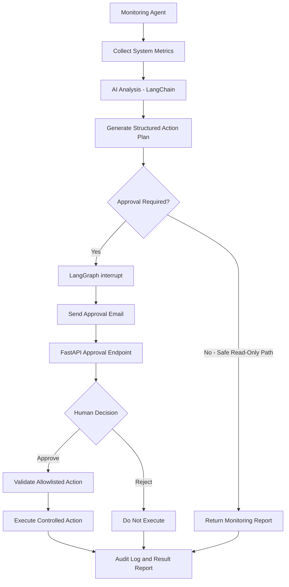

AI-Powered DevOps Automation Agent
Production-Oriented Automation with LangChain, LangGraph, and Human-in-the-Loop (HITL)
An AI-powered DevOps automation platform that monitors infrastructure,
detects operational issues, proposes remediation plans, and executes
approved actions only after explicit human authorization.
Core principle: Let AI analyze and recommend. Let humans
authorize. Let the system execute safely.

Table of Contents
- Project Overview
- Key Capabilities
- Example Workflow
- Architecture
- Technology Stack
- Project Structure
- Human-in-the-Loop Approval
- Security Principles
- Development Roadmap
- Future Enhancements
- Getting Started
- Project Goals
Project Overview
The AI-Powered DevOps Automation Agent is designed to combine
infrastructure monitoring, AI-assisted analysis, and controlled
remediation in one workflow.

The agent collects system metrics, identifies potential problems, and
prepares remediation recommendations. For critical or potentially
destructive operations, it pauses and requests approval through email
before execution.

The project uses LangChain for LLM integration and tools,
LangGraph for workflow orchestration and Human-in-the-Loop (HITL),
and FastAPI for approval endpoints.

This repository is being developed as a production-oriented project.
Production readiness will require the security, persistence, testing,
observability, and deployment work described in this README.
Key Capabilities
Infrastructure Monitoring
- CPU utilization monitoring
- Memory utilization monitoring
- Disk usage monitoring
- Docker container and image monitoring
- Linux service health checks
- Planned support for Windows services and hosts
- Multi-server monitoring as a planned capability
AI-Powered Analysis
- Analyze collected system metrics
- Identify abnormal resource utilization
- Classify operational risk
- Generate structured remediation recommendations
- Propose actions without directly executing arbitrary commands
Human Approval
- Pause workflows when an action requires authorization
- Send approval requests by email
- Support Approve and Reject decisions
- Resume the same LangGraph workflow after a valid decision
- Record approval and execution outcomes
Reporting and Auditability
- Record workflow outcomes
- Track approval decisions and timestamps
- Send execution result notifications
- Maintain server-wise alert and approval history as the platform
  evolves
Example Workflow
Imagine a Linux server reaches 92% disk utilization.

The agent:
1. Collects disk and system metrics.
2. Detects that disk usage has crossed the configured threshold.
3. Inspects relevant disk usage information.
4. Identifies candidate cleanup actions and estimates potential
   reclaimed space.
5. Creates a structured remediation plan.
6. Sends an approval request to the administrator.
7. Pauses until a valid human decision is received.
8. Executes the approved, allowlisted action---or performs no
   destructive action if rejected.
9. Records the result and sends a report.
Example proposed action:
docker image prune -f
This command is an illustrative example. It must not be executed
automatically just because an LLM proposed it. The application must
validate the action against an allowlist, show the scope and impact to
the approver, and require explicit authorization.
Architecture

Main Components
1. Monitoring Agent --- collects infrastructure metrics and health
   information.
2. AI Analysis Engine (LangChain) --- interprets metrics and
   proposes structured remediation plans.
3. Workflow Orchestration (LangGraph) --- manages state, branching,
   pausing, and resuming.
4. Approval API (FastAPI) --- validates approval decisions and
   connects them to the paused workflow.
5. Email Service --- sends approval requests and execution reports.
6. Persistence and Audit Layer --- stores workflow checkpoints,
   approval history, and execution events.
Technology Stack
  Technology            Purpose
  Python                Core programming language
LangChain             LLM integration, prompts, and tools
LangGraph             Workflow orchestration, state, and HITL
FastAPI               Approval API and backend endpoints
Gmail SMTP            Approval and result notifications
SQLite / PostgreSQL   Application data and approval history
psutil                System resource monitoring
pathlib               File and directory inspection
Docker                Containerization and deployment
Linux                 Primary DevOps execution environment
React                 Planned web dashboard
JWT                   Planned authentication and authorization
Project Structure
The target modular structure is:
devops-ai-agent/
│monitoring_ai_agent/
│
├── agent/
│   └── router.py
│
├── api/
│   ├── __init__.py
│   └── webhook_server.py
│
├── core/
│   ├── __init__.py
│   ├── graph.py
│   └── state.py
│
├── database/
│
├── nodes/
│   ├── analyze_with_ai.py
│   ├── evaluate_risk.py
│   ├── execute_action.py
│   ├── metrics_collection.py
│   ├── reject_action.py
│   ├── request_approval.py
│   └── send_approval_email.py
│
├── services/
│   ├── __init__.py
│   ├── db_connection.py
│   ├── email_service.py
│   ├── email_template.py
│   └── llm.py
│
├── tests/
│
├── tools/
│   ├── __init__.py
│   └── system_monitor.py
│
├── .env
├── .gitignore
├── dockerfile
├── main.py
└── readme.md

The repository may evolve as implementation progresses. Keep this
structure aligned with the actual codebase.
Human-in-the-Loop Approval
LangGraph's interrupt() is used to pause a workflow when a human
decision is required. After the approval endpoint validates the
decision, Command(resume=...) resumes the same workflow thread.
Approval lifecycle
1. LangGraph reaches the approval step.
2. The workflow pauses using interrupt().
3. The application sends an approval email.
4. The administrator opens the approval link and confirms the decision.
5. FastAPI validates the signed token and request status.
6. The application resumes the workflow using the same thread ID and
   persistent checkpointer.
7. The workflow follows the approved or rejected branch.
8. The outcome is recorded and reported.
Decision paths
Approved
- Validate the approval request and action.
- Confirm that the action is allowlisted and its parameters are valid.
- Resume the workflow.
- Execute the approved action through a controlled tool.
- Record the result.
Rejected
- Resume or conclude the workflow through the rejection branch.
- Do not execute the proposed destructive action.
- Record the rejection decision.
A production implementation must also handle expired requests, duplicate
clicks, invalid tokens, failed executions, interrupted email delivery,
and application restarts.
Security Principles
Security is a core requirement, not a later add-on.
- The LLM must never receive unrestricted shell execution access.
- Only predefined, allowlisted operations may be executed.
- Validate action names and parameters independently of the LLM
  output.
- Require explicit human approval for critical or destructive actions.
- Use signed, expiring, single-use approval tokens.
- Bind each approval to a specific request, action, parameters, and
  workflow thread.
- Use persistent LangGraph checkpointing so pending workflows can
  survive restarts.
- Use least-privilege operating-system permissions.
- Start with dry-run execution and test against disposable
  environments.
- Store secrets in environment variables or a dedicated secrets
  manager.
- Never commit .env, credentials, private keys, or tokens.
- Maintain audit records for requests, decisions, and execution
  outcomes.
- Protect approval endpoints with appropriate authentication,
  authorization, rate limits, and CSRF protections where applicable.
Development Roadmap
The project will be developed incrementally, with practical

implementation and testing at each stage.
  Stage                   Focus                   Main Deliverables
  Day 1                   System Monitoring       CPU, memory, disk,
process, Docker, and
service metrics

  Day 2                   LangChain Tools         Custom monitoring tools
and tool calling

  Day 3                   LangGraph               StateGraph, nodes,
edges, conditional
routing, and
checkpointer

  Day 4                   Email Integration       Gmail SMTP, approval
templates, and result
notifications

  Day 5                   Human-in-the-Loop       interrupt(), approval
decisions, and
Command(resume=...)

  Day 6                   FastAPI Integration     Approval endpoints,
token validation, and
workflow integration
Day 7                   Production-Oriented     Docker, database
Deployment              persistence, logging,
audit trail, security,
and end-to-end tests
The schedule is a learning and implementation sequence; production
hardening may require additional iterations.
Future Enhancements
  Feature                                 Priority
Multiple server monitoring              High
Linux and Windows support               High
Secure authentication (JWT)             High
React-based dashboard                   High
Server-wise alert history               High
Approval audit logs                     High
Role-Based Access Control (RBAC)        High
Docker-based deployment                 High
Multi-tenant SaaS architecture          High
Advanced monitoring and reporting       Medium
Automated incident classification       Medium
Slack / Microsoft Teams notifications   Medium
Prometheus and Grafana integration      Medium
Getting Started
Prerequisites
- Python 3.10 or a compatible version required by the selected
  dependencies
- Git
- A Linux test host or a disposable Linux virtual machine for
  infrastructure-action testing
- Docker, if using Docker monitoring
- Gmail SMTP credentials or an authorized SMTP service
- An LLM provider API key, if using a hosted model
1. Clone the repository
git clone <your-repository-url>
cd devops-ai-agent
2. Create and activate a virtual environment
Linux / macOS:
python3 -m venv .venv
source .venv/bin/activate
Windows PowerShell:
python -m venv .venv
.venv\Scripts\Activate.ps1
3. Install dependencies
pip install -r requirements.txt
4. Configure environment variables
Create a local .env file based on .env.example.

Example configuration keys (adapt them to the application's actual
settings):
APPROVAL_SECRET=replace_with_a_strong_random_secret
APPROVAL_BASE_URL=http://127.0.0.1:8000

GMAIL_USER=your_email@gmail.com
GMAIL_APP_PASSWORD=your_gmail_app_password

OPENAI_API_KEY=your_api_key
Do not use these example values in production. Do not commit the real
.env file.
5. Run the application
The exact startup commands depend on the implemented entry points. For a
FastAPI application exposed as app in approval_server.py, a
development server can be started with:
uvicorn approval_server:app --host 127.0.0.1 --port 8000
Run the workflow using the project's configured entry point. Confirm
that the graph and approval API use the same compiled LangGraph
application and persistent checkpointer.
Important: This README describes the intended project
architecture. Update the commands, environment variables, and folder
tree to match the current implementation before treating them as
definitive setup instructions.

Project Goals
The long-term goal is to build a secure, maintainable, and extensible
DevOps automation platform that can:
- Monitor multiple servers and environments.
- Detect infrastructure issues using system metrics.
- Use AI to analyze incidents and propose remediation plans.
- Pause critical workflows for human authorization.
- Execute only validated and approved actions.
- Preserve workflow state across application restarts.
- Provide centralized alerting, reporting, and audit history.
- Support secure, containerized deployment.
- Evolve toward a multi-tenant SaaS product.
Project Status
Development status: In progress

The project is being developed incrementally, starting with system
monitoring and progressing toward AI-assisted analysis, email-based
approval, persistent workflows, secure execution, and
production-oriented deployment.